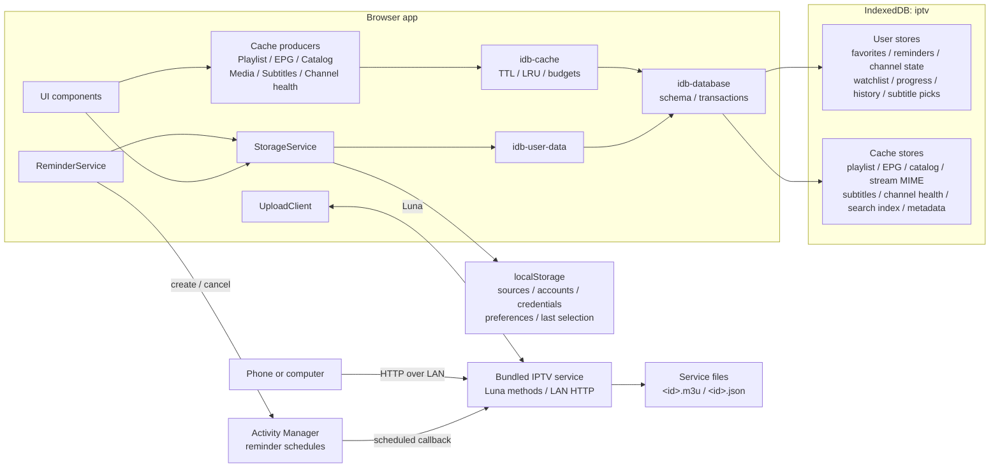

# Storage and Data Management

The app keeps your setup and viewing state on the TV so it can reopen quickly
and remember where you left off. It separates important user data from
downloaded data that can be recreated.

## What is stored

| Data | Examples | Where it is kept | Removed by Clear Cache? |
| --- | --- | --- | --- |
| Setup and preferences | Playlist and EPG sources, Xtream account details, theme, language, text size, time zone, active account and channel | Small app-private browser storage | No |
| Personal data | Favorites, reminders, channel order and names, hidden channels, Watchlist, Recently Watched, playback progress, audio and subtitle choices | App-private database on the TV | No |
| Downloaded cache | Parsed playlists, program guides, movie and series catalogs, media metadata, downloaded subtitles, channel health results | App-private database on the TV | Yes |
| LAN-uploaded playlists | Original M3U files uploaded from another device | Private storage owned by the bundled upload service | No |

## Implementation architecture

The persistence layer has four modules with deliberately separate
responsibilities:



- `src/services/storage-service.ts` is the application-facing facade. It keeps
  user data in memory so existing getters remain synchronous.
- `src/services/idb-user-data.ts` owns durable, non-evictable user records and
  serializes their writes.
- `src/services/idb-cache.ts` owns disposable records, byte accounting,
  expiration, LRU access times, budgeting, and eviction.
- `src/services/idb-database.ts` owns the shared IndexedDB schema, connection,
  requests, and transaction completion.
- `bundled-service/src/lan/` runs in the separate Node service because the
  webOS browser sandbox cannot listen on the LAN. `setup/` owns phone setup;
  `upload/` owns persisted M3U files.

### localStorage

Small boot-critical values retain the `iptv_` prefix. `StorageService` values
use JSON encoding; the logger's standalone `iptv_log_level` key is a raw string.
This is the complete active key inventory:

| Key | Type | Stored content | Classification |
| --- | --- | --- | --- |
| `iptv_playlists` | `PlaylistEntry[]` | Stable id, display name, source URL/type, uploaded channel count, and Xtream username, password, and live-output preference | Configuration |
| `iptv_manual_epg_sources` | `ManualEpgSource[]` | Manually added XMLTV URLs, in priority order, each applied to all playlists or to the listed playlist ids | Configuration |
| `iptv_selectedXtream` | `string \| null` | Account id used by Movies, Series, and Search | Navigation state |
| `iptv_catalog_sort_vod`, `iptv_catalog_sort_series` | `{by, direction}` | Movies and Series sort field (`default`, `name`, `added`, `rating`, `year`) and direction | Preference |
| `iptv_show_hidden_channels` | `boolean` | Whether normal lists reveal hidden channels in a dimmed state | Preference |
| `iptv_channel_cycle_mode` | `global \| active` | Whether Channel Up/Down cycles the whole list or stays in the group, Favorites, or playlist a channel was tuned from; default `active` | Preference |
| `iptv_live_reconnect_attempts` | `number` | Live channel reconnection limit (0–5; default 3) | Preference |
| `iptv_player_osd_timeout_ms` | `number` | How long the player controls stay up: 3000, 5000, 8000, 10000, or 12000 ms; default 5000 | Preference |
| `iptv_number_entry_osd_timeout_ms` | `number` | How long the number-entry overlay stays up after a digit: 1200, 1800, 2500, 3000, or 3500 ms; default 1200 | Preference |
| `iptv_playlist_refresh_interval_hours` | `number` | Channel-list refresh interval: 0 (off), 1, 3, 6, 12, or 24 hours; default 6 | Preference |
| `iptv_epg_refresh_interval_hours` | `number` | Program-guide refresh interval: 0 (off), 1, 3, 6, 12, or 24 hours; default 6 | Preference |
| `iptv_xtream_catalog_refresh_interval_hours` | `number` | Xtream Movies, Series, and Search catalog interval: 1, 3, 6, 12, or 24 hours; default 6 | Preference |
| `iptv_locale` | `string` | Explicit interface locale or `system` | Preference |
| `iptv_theme` | `string` | Selected application theme id | Preference |
| `iptv_text_size` | `string` | Selected text-scale id | Preference |
| `iptv_interface_size` | `90 \| 100 \| 110 \| 120 \| 130` | Whole-interface scale in percent | Preference |
| `iptv_animation_mode` | `essential \| reduced \| full` | Animation profile; defaults to immediate navigation scrolling, while Essential disables costly motion for older TVs | Preference |
| `iptv_overlay_style` | `dark \| frosted` | Player OSD/sidebar/picker glass style | Preference |
| `iptv_tz_mode` | `device \| feed` | Which time zone displays EPG times | Preference |
| `iptv_epg_tz_offset` | `number \| null` | Last known feed offset in minutes east of UTC | Small derived state |
| `iptv_epg_offsets` | `Record<string, number>` | User time correction in minutes, keyed by EPG source URL | Preference |
| `iptv_online_subtitles` | `OnlineSubtitleConfig` | Preferred language; SubDL and Assrt API keys; OpenSubtitles API key, username, password, access token, and token timestamp | Configuration and credentials |
| `iptv_tmdb_api_key` | `string` | The user's own TMDB v3 API key or v4 read access token for cast photos; empty means the app never contacts TMDB | Configuration and credentials |
| `iptv_parental_throttle` | `{failures, lockouts, blockedUntil}` | Wrong-PIN count and lockout end, kept here so restarting the app cannot reset the retry delay | Security state |
| `iptv_log_level` | `string` | Optional runtime logger threshold used by diagnostics | Developer preference |
| `iptv_fb_<store>` | `{r, d}` | Personal records kept while IndexedDB refuses writes, one key per user-data store (see [When IndexedDB refuses writes](#when-indexeddb-refuses-writes)) | Personal data fallback |

This lets the app discover its sources and render basic preferences before
opening IndexedDB. No fixed Web Storage capacity is assumed: it is intentionally
limited to small values because the effective webOS limit is implementation
dependent and much smaller than the origin quota available to IndexedDB.

If a localStorage write reports quota exhaustion, `StorageService` evicts
derived playlist and stream-MIME data and retries once. A second failure is
reported as `persistence.local.write.failed`; it is not silently treated as a
successful save.

### IndexedDB schema

The database is named `iptv`. webOS already isolates IndexedDB by application
origin, so object-store names do not repeat the `iptv_` prefix.

#### User-data stores

| Object store | Key examples | Additional indexes | Contents |
| --- | --- | --- | --- |
| `favorites` | `favorite:<channel-key>` | None | Stable channel keys |
| `reminders` | `reminder:<channel-key>\|<start-ms>` | None | Channel key/name, EPG source URL, program title, start/stop milliseconds, answered flag; `updatedAt` is the start time |
| `channel-state` | `custom:meta` | None | Customization version, channel/group order, and user-created group keys |
| `channel-state` | `custom:channel:<channel-key>` | None | Optional renamed display name, destination group, and hidden flag |
| `channel-state` | `custom:group:<group-key>` | None | Optional renamed group name and hidden flag |
| `channel-state` | `audio:<channel-key>` | None | Preferred audio rendition name and language |
| `channel-state` | `subtitle:<channel-key>` | None | Explicit off state or preferred subtitle name/language/CC mode |
| `channel-state` | `offset:<channel-key>` | None | Subtitle timing adjustment in seconds |
| `watchlist` | `watch:<account-id>\|<vod-or-series>\|<item-id>` | `scope` | Name, poster, rating, category, extension, and added time; scope is account and content kind |
| `playback-progress` | `resume:<account-id>\|<vod-or-episode>\|<item-id>` | `expiresAt`, `updatedAt` | Position, duration, title/poster/extension snapshot, optional autoplay queue and Watchlist owner |
| `playback-progress` | `watched:<account-id>\|<vod-or-episode>\|<item-id>` | `updatedAt` | A movie or episode played to its end, and when; dropped once it is watched again past the resume threshold or its progress is cleared; the newest 2000 are kept |
| `playback-progress` | `catchup:<channel-key>\|<program-start>` | `expiresAt`, `updatedAt` | EPG source URL, program start/stop, title/description/icon snapshot, position, completion, update time, and computed expiry |
| `recently-watched` | `live:<channel-key>` | `updatedAt` | Channel key and last-confirmed watch time; capped to 30 live entries |
| `online-sub-picks` | `pick:<account-id>\|<vod-or-episode>\|<item-id>` | None | Provider id, provider result id, display name, language, and subtitle format |

Every user store uses `key` as its key path. The common record shape is:

```ts
interface UserDataRecord<T> {
  key: string;
  value: T;
  scope?: string;
  updatedAt?: number;
  expiresAt?: number;
}
```

These stores are not included in cache accounting and are never passed to the
eviction algorithm.

#### Cache stores

| Object store | Key path | Indexes | Contents |
| --- | --- | --- | --- |
| `playlist-cache` | `key` | `expiresAt`, `lastAccessedAt` | Key `combined`; payload version, playlist-source signature, full parsed `Channel[]` including playback URLs/headers/catch-up metadata, derived EPG sources, and timestamp |
| `epg-cache` | `url` | `expiresAt`, `lastAccessedAt` | Parsed XMLTV channels, aliases/icons, program start/stop/title/description/category/icon, feed offset, optional channel filter, and timestamp |
| `catalog-cache` | `key` | `expiresAt`, `lastAccessedAt` | Xtream categories, VOD/series lists and details, and media-container probes |
| `stream-mime-cache` | `key` | `expiresAt`, `lastAccessedAt` | Normalized provider route mapped to detected MIME and probe time; accounted and evicted in the `catalog` category |
| `subtitle-cache` | `key` | `expiresAt`, `lastAccessedAt` | Provider/result key and downloaded SRT, WebVTT, ASS, or SSA text |
| `channel-health-cache` | `key` | `expiresAt`, `lastAccessedAt` | Per-channel healthy, suspect, or unavailable status from the latest stream check |
| `search-index-cache` | `key` | `expiresAt`, `lastAccessedAt` | Folded Search text of one playlist, guide, or catalog cache record, keyed by source store, source key, source timestamp, and index format; one string plus `Uint32Array` offsets. Written by the app worker after the page reserves room; clearing a source store removes its indexes |
| `cache-meta` | `category` | None | `{bytes, entries, updatedAt}` for `playlist`, `epg`, `catalog`, `subtitle`, `health`, `search`, and `total` |

Known `catalog-cache` key families are:

```text
<account-id>|vod_categories
<account-id>|vod_streams|<category-id>
<account-id>|vod_all
<account-id>|vod_info|<vod-id>
<account-id>|series_categories
<account-id>|series|<category-id>
<account-id>|series_all
<account-id>|series_info|<series-id>
<account-id>|media_probe|<vod-or-episode>|<item-id>
tmdb|<movie-or-tv>|<tmdb-id-or-imdb-tt-id>
```

Catalog list/detail payloads contain the provider's normalized names, ids,
posters, ratings, categories, stream extensions, plots, cast, genres, release
data, episode metadata, and sidecar-subtitle descriptors. Media probes contain
the parsed container information used by the OSD, such as codec, resolution,
frame rate, HDR, and audio-channel metadata. TMDB entries (only with a key) hold at most 24 credited people as name,
profile-image path, and character, kept 30 days (7 for a title TMDB does
not know); they are evicted with the rest of the catalog category.

Cache payloads are normalized to a shared envelope:

```ts
interface CacheFields {
  cacheCategory: 'playlist' | 'epg' | 'catalog' | 'subtitle' | 'health';
  createdAt: number;
  updatedAt: number;
  lastAccessedAt: number;
  expiresAt: number | null;
  byteSize: number;
}
```

`byteSize` is the UTF-8 size of the serialized JSON record when `TextEncoder`
is available; the fallback path uses two bytes per JavaScript character. It is
an accounting estimate, not IndexedDB's internal on-disk allocation.

Record mutations and their `cache-meta` changes commit in the same IndexedDB
transaction. Cache mutations also pass through one promise chain so two
concurrent updates cannot apply byte deltas to stale metadata. If metadata is
missing or predates this envelope, the app scans all cache stores and rebuilds
it.

The combined playlist uses the fixed key `combined`, payload version 2, and an
FNV-1a signature of the configured playlist JSON. A source edit therefore
invalidates a structurally valid but now unrelated parsed playlist.

### Cache freshness

| Category | Refresh setting | Read behavior |
| --- | --- | --- |
| Playlist | Off, 1, 3, 6, 12, or 24 hours; default 6 | Requires matching payload version, source signature, and non-empty channels. Startup uses a matching cache at any age; the current setting is compared with the stored timestamp to schedule the next refresh, which runs at once in the background when the cache is overdue. Off keeps a matching cache until its source configuration changes or the user refreshes all data |
| Program guide | Off, 1, 3, 6, 12, or 24 hours; default 6 | Each source retains its own timestamp. Off stops periodic refresh and ignores age, but a missing or structurally invalid source is still downloaded once so a cold cache can populate |
| Xtream catalog | 1, 3, 6, 12, or 24 hours; default 6 | Callers compare each entry's timestamp with the current setting. An expired list (categories, category items, or the whole Search catalog) is returned at once and re-fetched in the background for the next open; an expired detail is re-fetched before it is shown. There is no Off option, so Movies, Series, and Search cannot remain permanently stale |
| Media probe | No expiry | Stored in the catalog category and still subject to LRU/budget cleanup |
| Stream MIME probe | 7 days | Expired reads become misses; records participate in catalog LRU and accounting |
| Downloaded subtitle | 30 days | An expired read becomes a miss and deletes the record |
| Channel health result | 30 days | Expired results are discarded; a new health check replaces results for checked channels |
| Search index | 7 days | Used only while its source record's key, timestamp, and the index format still match; otherwise rebuilt from the source record. Built ahead of Search while the UI is idle after the channels load and after each playlist, guide, catalog, or account change |

Reads update `lastAccessedAt` in a best-effort follow-up transaction. Failure to
write this bookkeeping does not turn a valid cache hit into a miss.

### Refresh scheduling

The three settings are under **Settings → Advanced**. `CONFIG` provides their
defaults; runtime freshness uses the saved preferences and the age of the
loaded data. Off stops periodic channel-list or program-guide refresh, while
still allowing a missing guide cache to populate. Started on Home, the app
loads no channel list, guide, or catalog: it only asks each enabled Xtream
account to sign in (`player_api.php` with no action). The channels and guide
load the first time Live, the Guide, Search, Settings, a channel number, a
reminder launch, or a due reminder needs them, and their refresh timers start
then. Only a cold cache blocks that load on a channel-list download; an
overdue one is shown first and refreshed in the background. Xtream catalogs refresh when Movies, Series, or Search
accesses expired data and do not have an Off option. Background catalog
refreshes are shared per cache key, run at most two at a time with the rest
queued, survive leaving the view, keep the stale copy on a failed or empty
response, and are discarded if the catalog cache is cleared while they are
queued or in flight. A channel-list refresh records the source configuration
and cache state it started with; if either changes before it finishes, its
result is not written to the cache.

Every request to the provider (a channel-list or guide download, or an Xtream
API call) retries a transient failure up to three times, after 1, 2, then 4
seconds: a timeout, a network error, or HTTP 408, 429, or 5xx. A numeric
`Retry-After` replaces the step, up to 10 seconds. Other failures, such as a
rejected login, a missing list, or an unreadable response, surface at once,
and canceling the request stops a pending retry. The sign-in check in
Settings does not retry a timeout, so an unresponsive portal reports quickly. A retried download starts
over, so a failed attempt never adds partial data. Stream playback and
online subtitle searches do not use these retries.

An incomplete automatic channel-list refresh keeps the previous complete list
instead of publishing partial data. **Refresh All Data** remains available in
Off mode; it reloads enabled channel sources, forces the configured guide
sources to refresh, and clears Xtream catalog and related media-metadata caches.

The app does not provide account-based cloud sync or a remote backup of this
data. Playlist providers and subtitle services still receive the requests
needed to download their content.

Xtream credentials and source URLs are stored in the app's private webOS
storage. They are isolated from other normal TV apps, but the app does not add
its own encryption layer.

## Why the app uses a cache

Program guides and catalogs can be much larger than settings or favorites.
Keeping their processed versions on the TV makes startup, guide reopening, and
catalog browsing faster and reduces repeated provider downloads.

Cached data is disposable. If it expires, is cleared, or is automatically
removed to recover space, the app downloads or rebuilds it when needed. Personal
data is stored separately and is never selected for cache cleanup.

Channel logos are not copied into this managed cache. They use the TV browser's
normal image cache, so the cache total in Settings does not include them.

## Cache size and the displayed budget

Open **Settings -> Data Management** to see the managed cache total and its
breakdown:

- Playlists
- Program guide
- Catalog and media metadata
- Subtitles
- Channel health results
- Search index

The second number is a **soft cache budget**, not reserved or currently used
space. For example, `1.8 MiB / 75 MiB` means the managed cache currently uses
about 1.8 MiB and may grow toward a 75 MiB target.

The budget adapts to the storage quota reported by
`navigator.storage.estimate()`:

```text
budget = min(floor(reportedQuota * 0.5), 1 GiB)
```

webOS 4 has no `navigator.storage`, so the app reads the quota from the older
`navigator.webkitTemporaryStorage.queryUsageAndQuota()` instead. That API's
usage figure is unreliable (it reported 0 on a full origin), so only the
quota is used, and the cache's own byte count is the only guard. Stored
records take roughly twice their counted size on disk (a 9 MB catalog filled
a 19 MB quota), so this budget uses a quarter of the quota:

```text
budget = min(floor(legacyQuota * 0.25), 1 GiB)
```

If the TV cannot report a quota at all, the app uses a 4 MiB fallback
budget: the same rule applied to the smallest quota measured on a TV. The
result can therefore differ between TV models, webOS versions, and available
storage. A displayed budget of 75 MiB is normal when webOS grants the app a
quota of about 150 MiB; about 4.5 MiB is normal on webOS 4.

The displayed total covers only the managed cache. Small settings, personal
records, browser-managed image files, and original LAN-uploaded M3U files are
not included.

## Automatic cleanup

The app checks the cache before and after writes. Cleanup begins when the cache
would exceed its soft budget or when overall app storage approaches 80% of the
quota reported by webOS.

Cleanup removes data in this order:

1. Expired entries.
2. Least-recently-used Search indexes.
3. Least-recently-used subtitles.
4. Least-recently-used catalog and media metadata.
5. Least-recently-used program guides.
6. Least-recently-used parsed playlists.

A Search index never causes other data to be removed: it replaces older
indexes of the same source and is skipped when it would take more than 10% of
the room left in the budget. A failed index write is dropped without a retry.

This order favors quick startup and live TV while discarding content that is
usually cheap to download again. If webOS still rejects a write because storage
is full, the app performs another cleanup and retries once.

More precisely, an incoming write computes:

```text
cacheOver  = currentManagedCache + incomingDelta - softBudget
originOver = reportedOriginUsage + incomingDelta - 80% of reportedQuota
required   = max(cacheOver, originOver)
```

When `required` is positive, cleanup removes at least that amount plus the
larger of 4 MiB or 10% of the incoming delta. The margin avoids running another
scan immediately after the next small write. A native `QuotaExceededError`
triggers a second path that prunes the incoming record size plus 4 MiB, then
retries the write once.

Cleanup commits its deletions in a transaction of their own, before the
updated totals: a full origin rejects any transaction that writes data, so a
combined one would never free space. If the totals cannot be written, they
are rebuilt from the stores on next use.

### Personal data comes first

Personal records share the origin quota with the cache. When webOS rejects a
personal-data write, or the exit-time snapshot retry, with a quota error, the
app clears whole cache stores until the freed space reaches 4 MiB, in this
order: Search indexes (always), catalog and media metadata, program guides,
subtitles, channel health results, stream MIME types, and finally parsed
playlists. It then retries the write once and logs
`persistence.user.quota.evicted` with the outcome. If the retry is
rejected for quota too, IndexedDB is treated as read-only for the session
(see below). Personal-data stores are never cleared.

### When IndexedDB refuses writes

Chromium 53 (webOS 4) keeps 1 GiB of free disk for the system
(`kMinimumPreserveForSystem` in its quota manager). Below that, it allows
an origin no growth at all, while `queryUsageAndQuota()` still reports a
temporary quota: one fifth of a third of the free space plus usage, about
18 MB on a TV with 270 MB free. Every IndexedDB put then aborts with
`QuotaExceededError`, even a 10-byte one into an empty database, and reads
keep working. Many 4 GB webOS 4 TVs never have 1 GiB free, so on them this is
the normal state, not a passing one.

At startup the app writes one small record to `user-meta`. If that write,
or any later personal-data write, is still rejected for quota after the cache
eviction above, IndexedDB is read-only for the rest of the session, and the
app logs `storage.idb.readonly` once with the number of records the fallback
already holds. From then on:

- **Personal records** go to localStorage, one `iptv_fb_<store>` key per
  user-data store, holding the records written and the keys deleted since.
  Reads merge them over the IndexedDB records, so nothing stored before
  disappears. Each store keeps its most recent records and as many deletions:

  | Store | Records kept |
  | --- | --- |
  | `favorites` | 500 |
  | `reminders` | 200 |
  | `channel-state` | 1000 |
  | `watchlist` | 400 |
  | `playback-progress` | 1000 |
  | `recently-watched` | 30 |
  | `online-sub-picks` | 200 |
  | `parental-control` | 1 |

  All fallback keys together hold at most 1 Mi characters (2 MiB as UTF-16,
  of Chromium's 5 Mi-character localStorage), and the oldest records across
  stores go first; the parental-control record is never evicted. When a
  setup or preference key cannot be saved even after the derived caches are
  evicted, the oldest half of the fallback is dropped to make room for it.
  Fallback writes never evict any other key.
- **Caches** (playlists, guides, catalogs, subtitles, stream MIME types,
  channel health) are kept in memory for the session only, up to 32 MiB of
  counted size, and Search indexes are not stored. They never use
  localStorage.
- No save-failure message is shown, on exit or otherwise. While the
  session is read-only, **Settings → Data Management** notes under the
  cache total that the TV limits app storage and the cache is not kept
  between launches.

In a later session where the startup write succeeds, the app writes the
fallback records into IndexedDB, removes the `iptv_fb_*` keys, and logs
`storage.idb.restored`.

The category order is implemented after a global expired-record pass. Within
each category, candidates sort by ascending `lastAccessedAt`, giving LRU
behavior among the records known to the cache manager.

## Clear Cache and Reset App

### Clear Cache

**Clear Cache** removes downloaded and processed data, including cached channel
health results. It keeps:

- Accounts and source settings
- App preferences
- Favorites and reminders
- Channel customization
- Watchlist and Recently Watched
- Playback progress
- Audio and subtitle choices
- Original LAN-uploaded M3U files

The next use of a cleared area may be slower while its data is downloaded and
processed again.

### Reset App

**Reset App** permanently removes the app's local setup, personal data, and
managed cache, then restarts at initial setup.

Original LAN-uploaded M3U files belong to the separate LAN service and are
not part of the browser database or cache meter. They should be removed through
the playlist/upload workflow if they must also be deleted; otherwise the app
may discover them again after a reset.

## Storage outside the browser origin

### Bundled-service upload files

The upload store chooses the first writable directory in this order:

```text
WEBOS_UPLOAD_DIR environment override
/media/internal/iptv-uploads
<service-install-directory>/uploads
/tmp/iptv-uploads
```

The first two usable locations are intended to survive reboot. `/tmp` is only a
last-resort fallback and is not persistent across reboot.

Each upload creates two files:

| File | Stored content |
| --- | --- |
| `<id>.m3u` | Original validated M3U text |
| `<id>.json` | `{id, name, count, createdAt}` metadata |

The HTTP `DELETE /uploads/<id>` route deletes both files. The browser-side
`iptv_playlists` entry for an uploaded source is a synchronized reference to
these service-owned files, not another copy of the M3U.

### webOS Activity Manager

Every pending reminder also creates a persistent OS activity named:

```text
iptvReminder-<channel-key>-<start-ms>
```

The activity stores its local scheduled time and callback. In Developer Mode
the callback targets the bundled service and carries the truncated title,
channel name/key, application id, and localized alert labels. In retail mode it
targets `createToast` with the application id and localized message. These OS
activities duplicate only the scheduling information needed to wake at the
correct time; the authoritative reminder record remains in IndexedDB.

Removing or pruning a reminder sends Activity Manager a best-effort cancel by
activity name. Loading the channels reschedules every still-pending reminder with
`replace: true`, repairing missing OS activities without creating duplicates.
Changing an EPG source's time correction migrates reminder and catch-up keys to
the corrected program time. The old reminder activity is canceled and replaced.

### Browser-managed HTTP cache

Channel logos and normal fetched resources may enter Chromium's HTTP cache.
The app does not enumerate or account for those files, and Clear Cache only
clears the app-managed IndexedDB cache. The application does not currently use
the Cache Storage API, `sessionStorage`, or cookies for its own persistence.

## Write ordering and recovery

Changes appear immediately in the interface and are queued for durable storage.
Each logical update diffs the previous and next record sets into `put` and
`delete` operations, then commits them in one transaction for that store.
`idb-user-data` serializes all writes through `writeChain`, preserving call
order even when a prior operation rejects. The first asynchronous failure is
latched for the next flush.

The app flushes pending writes when it moves to the background and before an
explicit exit. A failed flush triggers one recovery attempt:

1. Serialize the complete current in-memory user-data snapshot.
2. Replace all seven user-data stores in one transaction.
3. Wait for the write chain again.

If recovery succeeds, the flush emits a recovered event. If it still fails, an
explicit exit is canceled, the app remains open, and a save-failure toast is
shown instead of silently losing the latest changes.

When IndexedDB cannot open, initialization logs the failure. Destructive
operations such as Clear Cache and Reset App do not report success when
IndexedDB is unavailable.

### Reset transaction order

Reset is intentionally ordered so local configuration is not erased before a
database failure can be reported:

1. Clear all derived cache stores and `cache-meta`.
2. Clear all user-data stores and internal metadata.
3. Clear localStorage.
4. Emit the completion event.
5. Reload the app.

If either database clear fails, Settings shows an error and leaves the
remaining local configuration intact.

## Diagnostics

Persistence logs use stable component tags:

| Tag | Responsibility |
| --- | --- |
| `PersistenceDB` | Open, blocked open, and schema upgrade |
| `CacheStorage` | Cache reads, writes, accounting, quota, eviction, and clear |
| `UserDataStorage` | User-record writes, recovery, and clear |
| `StorageService` | localStorage quota handling and facade initialization |
| `App` | Background/exit flush and whole-app reset |

Important records include machine-readable `event=` fields such as
`persistence.cache.budget.exceeded`, `persistence.user.flush.recovered`, and
`persistence.reset.completed`. `scripts/tv.sh diag` uses these events to report
quota, write, flush, and reset failures without parsing prose.

`src/services/persistence-diagnostics.test.ts` statically enforces that every
info, warning, and error emitted by the persistence modules carries an event
identifier.

Because there is no cloud backup, **Reset App**, uninstalling the app, or
clearing its webOS application data can permanently remove local user data.
